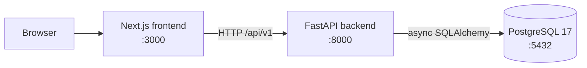
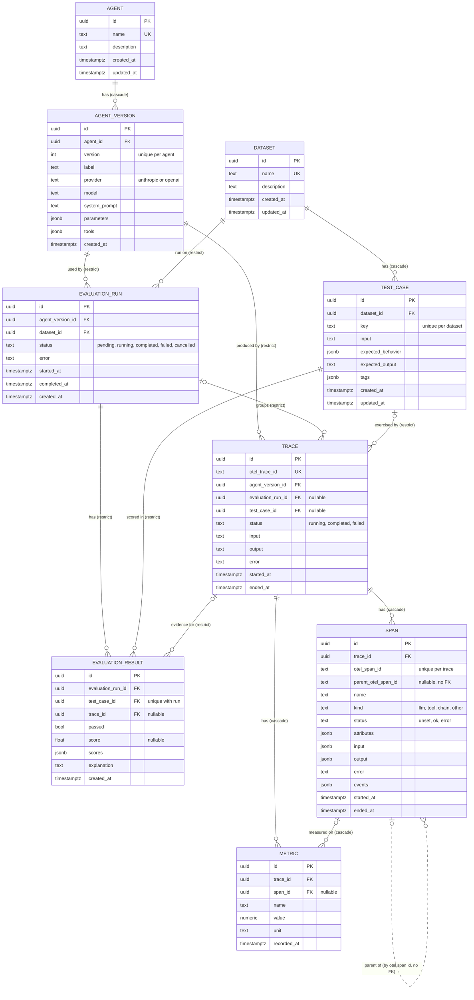

# Architecture

AgentOps is an evaluation and monitoring platform for AI agents. This page describes the M0 foundation: how the pieces fit together, the data model, and the API. The design rationale lives in [the M0 spec](specs/2026-11-17-m0-architecture-design.md).

## Overview

- The **frontend** (Next.js) is the only thing a browser talks to.
- The **backend** (FastAPI) owns all business logic and exposes a REST API under `/api/v1`. Its OpenAPI spec is generated from the code and is the source of truth for the API.
- **PostgreSQL** stores everything. Schema changes go through Alembic migrations.

Inside the backend, each request flows `api/` (routing and validation) → `services/` (business logic, transactions) → `models/` (SQLAlchemy tables). `schemas/` holds the Pydantic request and response models.

## Data model

All nine entities have tables in M0. Only Agent, AgentVersion, Dataset and TestCase have endpoints so far. The rest are filled in by later milestones.

Conventions: primary keys are UUIDs generated by the database (`gen_random_uuid()`); timestamps are `timestamptz` set server-side (`updated_at` by a trigger); flexible fields are JSONB; enums are `text` columns with `CHECK` constraints rather than native Postgres enums.

**Spans link to their parent by OTel span ID.** `spans.parent_otel_span_id` holds the parent's `otel_span_id` and is resolved within the same trace. It has no foreign key, because OpenTelemetry exports a child before its parent, and a span whose parent isn't stored is read as a root. Spans reach the database only through `app.observability.ingest.ingest_spans`, which accepts them in any order and is idempotent on `(otel_trace_id, otel_span_id)`.

**AgentVersions are immutable.** There is no update endpoint and no standalone delete. A change to an agent means a new version, numbered server-side. This is what keeps later version comparisons trustworthy.

### Deletion rules

History is never silently destroyed.

| Relationship | Rule | Effect |
| ------------ | ---- | ------ |
| Agent → AgentVersion | `CASCADE` | Deleting an agent deletes its versions. |
| Dataset → TestCase | `CASCADE` | Deleting a dataset deletes its test cases. |
| Trace → Span, Trace → Metric, Span → Metric | `CASCADE` | Removed together with the trace. |
| EvaluationRun, Trace, EvaluationResult → their targets (AgentVersion, Dataset, TestCase, EvaluationRun, Trace) | `RESTRICT` | The target cannot be deleted while a historical record points at it. |

In practice, the API returns `409` when:

- an Agent is deleted and any of its versions is referenced by a run or trace,
- a Dataset is deleted and any of its test cases is referenced by a trace or result (or a run references the dataset),
- a TestCase is deleted and a Trace or EvaluationResult references it.

If nothing references them, the cascade rules apply and the delete succeeds.

## API

The API is code-first: FastAPI generates the OpenAPI spec from the routes and schemas. With the backend running, browse the interactive docs at [`/docs`](http://localhost:8000/docs) (Swagger UI), or fetch the raw spec from [`/openapi.json`](http://localhost:8000/openapi.json).

All routes live under `/api/v1`, except health.

| Method and path | Purpose |
| --------------- | ------- |
| `GET /health` | `{status, database}`. 200 if the database is reachable, 503 otherwise. |
| `GET`, `POST /api/v1/agents` | List and create agents. |
| `GET`, `PATCH`, `DELETE /api/v1/agents/{id}` | Read, update and delete an agent. |
| `GET`, `POST /api/v1/agents/{id}/versions` | List versions and create the next one. |
| `GET /api/v1/agents/{id}/versions/{version}` | Read one version. Versions have no update or delete. |
| `GET`, `POST /api/v1/datasets` | List and create datasets. |
| `GET`, `PATCH`, `DELETE /api/v1/datasets/{id}` | Read, update and delete a dataset. |
| `GET`, `POST /api/v1/datasets/{id}/test-cases` | List and create test cases. |
| `POST /api/v1/datasets/{id}/test-cases:bulk` | Create 1 to 1000 test cases. All-or-nothing: a duplicate key in the request or against existing cases returns `409` and inserts nothing. |
| `GET`, `PATCH`, `DELETE /api/v1/datasets/{id}/test-cases/{case_id}` | Read, update and delete a test case. |
| `GET /api/v1/traces` | List traces, newest first. Filters: `agent_version_id`, `status` (`running`, `completed` or `failed`). |
| `GET /api/v1/traces/{id}` | Read a trace and its spans as a tree: `spans` holds the root spans, each with nested `children` ordered by `started_at`. A span whose parent isn't in the trace is returned as a root. |

Conventions:

- Lists take `limit` (default 50, max 200) and `offset`, and return `{items, total, limit, offset}`.
- Errors use `{"detail": ...}`: `404` not found, `409` uniqueness or referential conflict, `422` validation.

## Sample data

`make seed` loads [`datasets/sample.json`](../datasets/sample.json) (one agent with one version, and the `weather-basics` dataset with three test cases) into the database named by `DATABASE_URL`. It is idempotent: rows that already exist are skipped, so running it again creates nothing.
